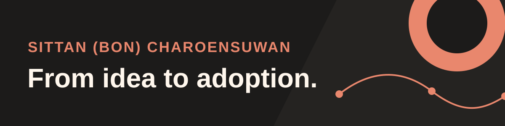

  

### Hi, I'm Bon

I turn emerging technology into practical solutions people want to use. My work connects **AI implementation, process automation, product thinking and human adoption**: finding the right problem, proving an approach with evidence, and making it part of everyday work. Based in Munich.

**[Explore my portfolio](https://sittanbon.github.io/)** | **[View my journey and CV](https://sittanbon.github.io/journey.html)** | **[Connect on LinkedIn](https://www.linkedin.com/in/sittan-charoensuwan/)**

---

### Technical skills in practice

**n8n | LLM APIs (OpenAI, Anthropic, Gemini) | AI agents | MCP | Python | SQL | React | React Native | Expo | TypeScript | JavaScript | Node.js | Express | SQLite | REST APIs | accessible interfaces | testing**

I use these tools to move from a useful idea to a tested product or workflow. **[Explore the visual skills page](https://sittanbon.github.io/skills.html)**. Each skill links to public code or a clearly labeled case study.

### Selected work

**01 / GenAI campaign workflow** | Delivered rollout  
Built an n8n proof of concept, tested it at two AI-enabled and two comparison locations, then rolled it out across four DACH locations. Content creation time went from about four weeks to 1.5 weeks, with human approval and GDPR data minimisation built in. **[Read the case study](https://sittanbon.github.io/genai-workflow-case-study.html)**

**02 / AI Expense Intelligence** | Internal pilot and product concept  
Interviewed 30+ SME finance users, tested OCR extraction on 500+ receipts, and designed confidence-based routing: high-confidence receipts are booked automatically, uncertain ones and items that don't match the project go to a person, duplicates are rejected, and large claims always go to the budget manager. **[Read the case study](https://sittanbon.github.io/finance-ai-case-study.html)**

**03 / Bierpreis** | Live product  
A bilingual Munich beer-price map at **[bierpreis.beer](https://bierpreis.beer/)**: around 180 venues across six districts, community price reports with an admin review queue, honest price-freshness labels, and a mobile-first map and list. **[View code](https://github.com/SittanBon/muenchner-bierpreis)**

**04 / Lead-intelligence automation** | Team project in development (WBS CODING SCHOOL)  
An n8n and LLM-agent workflow for a training-consulting firm. It collects client notes from several sources (OneNote, Google Keep and similar), turns them into structured lead profiles, scores and prioritises each lead, and routes it to the responsible consultant.

**05 / Prompt Smash!** | Independent build  
An interactive guide that teaches prompt design through four journeys, with a responsible-AI review in every journey. It runs in the browser and keeps learners' drafts on their device. **[Try it](https://sittanbon.github.io/prompt-smash/)** | [View code](https://github.com/SittanBon/prompt-smash)

**06 / Mochi Pop** | Playable independent build  
A cross-platform stress-relief tapping game built with Expo and React Native. Combos, candy, XP, pet care and unlockable looks create a playful loop, and progress saves on the device. **[Play the browser preview](https://sittanbon.github.io/mochi-pop/)** | [View code](https://github.com/SittanBon/mochi-pop)

**07 / QR Event Management** | Pilot and market learning  
Piloted a QR event product and pitched it to 40 companies, 10 of which adopted it in the first quarter. Designed the licensing strategy under which five market competitors licensed it. **[Read the case study](https://sittanbon.github.io/event-engagement-case-study.html)**

**[See the project workflow diagrams](WORKFLOWS.md)**

### More to explore

- **[Creative experiences](https://sittanbon.github.io/creative-experiences.html)**: brand communication, digital interaction and audience engagement.
- **[Technology experience](https://sittanbon.github.io/technology-experience.html)**: IIoT research and roadmapping, academic research and hands-on prototypes.
- **[AI at Work: The Legal Layers](https://sittanbon.github.io/ai-legal-layers/)** and **[Ethical AI Now](https://sittanbon.github.io/ethical-ai-now/)**: practical resources for responsible AI use.

### How I work

**Imagine** the opportunity, **shape** a useful solution, **prove** it with evidence, and **adopt** it with people.

If you are working on a problem where technology, business and human behaviour meet, **[let's connect](mailto:sittan.siri@gmail.com)**.
