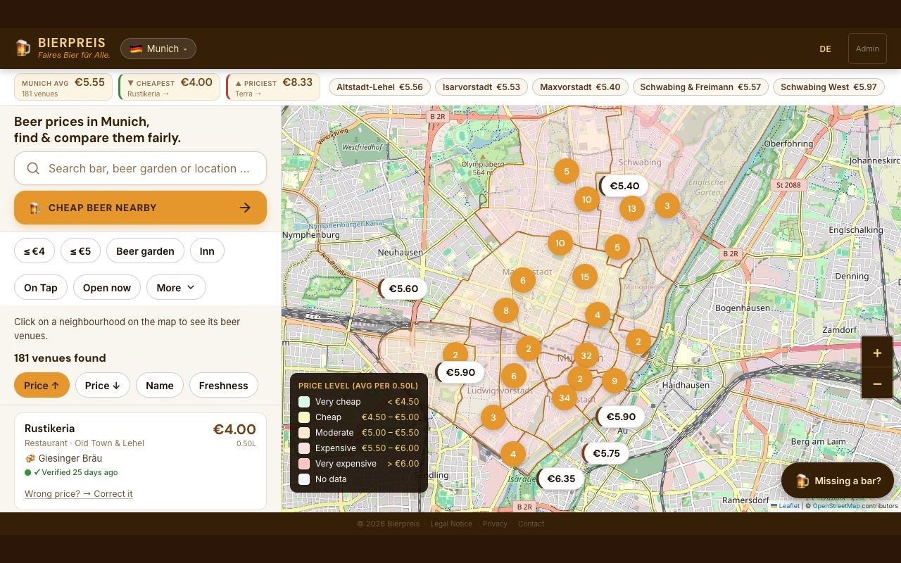
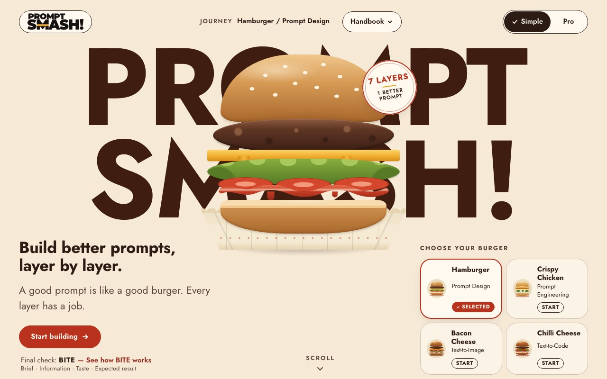
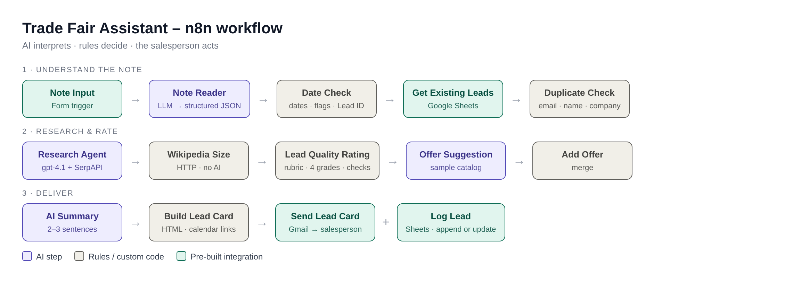
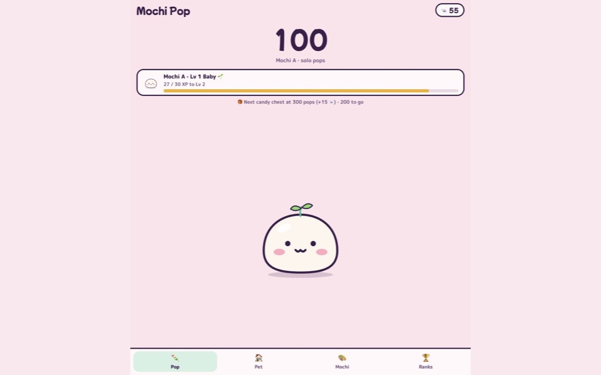

  

### Hi, I'm Bon

I turn emerging technology into practical solutions people want to use. My work connects **AI implementation, process automation, product thinking and human adoption**: finding the right problem, proving an approach with evidence, and making it part of everyday work. Based in Munich.

**[Explore my portfolio](https://sittanbon.github.io/)** | **[View my journey and CV](https://sittanbon.github.io/journey.html)** | **[Connect on LinkedIn](https://www.linkedin.com/in/sittan-charoensuwan/)**

---

### Technical skills in practice

**n8n | LLM APIs (OpenAI, Anthropic, Gemini) | AI agents | MCP | Python | SQL | React | React Native | Expo | TypeScript | JavaScript | Node.js | Express | SQLite | REST APIs | accessible interfaces | testing**

I use these tools to move from a useful idea to a tested product or workflow. **[Explore the visual skills page](https://sittanbon.github.io/skills.html)**. Each skill links to public code or a clearly labeled case study.

### Selected work

<table>
  <tr>
    <td width="50%" valign="top">
      
       <strong>Bierpreis</strong> · <em>Live product</em> 
      A bilingual Munich beer-price map: around 180 venues across six districts, community price reports with an admin review queue, and honest price-freshness labels. 
      <a href="https://bierpreis.beer/">Visit bierpreis.beer</a> · <a href="https://github.com/SittanBon/muenchner-bierpreis">Code</a>
    </td>
    <td width="50%" valign="top">
      
       <strong>Prompt Smash!</strong> · <em>Independent build</em> 
      An interactive guide that teaches prompt design through four journeys, with a responsible-AI review in every journey. Learners' drafts stay on their device. 
      <a href="https://sittanbon.github.io/prompt-smash/">Try it</a> · <a href="https://github.com/SittanBon/prompt-smash">Code</a>
    </td>
  </tr>
  <tr>
    <td colspan="2" valign="top">
      
       <strong>Trade Fair Assistant</strong> · <em>Course project, working prototype (WBS CODING SCHOOL)</em> 
      An n8n workflow that turns messy trade fair notes into a researched, scored lead card in the salesperson's inbox. An LLM structures the note, an AI agent researches the company with sources, and fixed rules calculate the score, four grades and next steps. It flags uncertain contacts, duplicates and possible company mix-ups, and it never e-mails the lead. Tested with fictional notes. 
      <a href="https://github.com/SittanBon/trade-fair-assistant">Code and test learnings</a>
    </td>
  </tr>
  <tr>
    <td width="50%" valign="top">
      
       <strong>Mochi Pop</strong> · <em>Playable independent build</em> 
      A cross-platform stress-relief tapping game built with Expo and React Native. Combos, candy, XP, pet care and unlockable looks; progress saves on the device. 
      <a href="https://sittanbon.github.io/mochi-pop/">Play the browser preview</a> · <a href="https://github.com/SittanBon/mochi-pop">Code</a>
    </td>
    <td width="50%" valign="top">
      <strong>Case studies from client work</strong>
        
      <strong><a href="https://sittanbon.github.io/genai-workflow-case-study.html">GenAI campaign workflow</a></strong> · <em>Delivered rollout</em> 
      n8n proof of concept, tested at two AI-enabled and two comparison locations, then rolled out across four DACH locations. Content creation time went from about four weeks to 1.5 weeks, with human approval and GDPR data minimisation built in.
        
      <strong><a href="https://sittanbon.github.io/finance-ai-case-study.html">AI Expense Intelligence</a></strong> · <em>Internal pilot and product concept</em> 
      Interviewed 30+ SME finance users and tested OCR extraction on 500+ receipts. Confidence-based routing: high-confidence receipts are booked automatically, uncertain ones and items that don't match the project go to a person, duplicates are rejected, and large claims always go to the budget manager.
        
      <strong><a href="https://sittanbon.github.io/event-engagement-case-study.html">QR Event Management</a></strong> · <em>Pilot and market learning</em> 
      Piloted a QR event product and pitched it to 40 companies, 10 of which adopted it in the first quarter. Five market competitors licensed it under the licensing strategy I designed.
    </td>
  </tr>
</table>

**[See the project workflow diagrams](WORKFLOWS.md)** | **[All work on the portfolio](https://sittanbon.github.io/)**

### More to explore

- **[Creative experiences](https://sittanbon.github.io/creative-experiences.html)**: brand communication, digital interaction and audience engagement.
- **[Technology experience](https://sittanbon.github.io/technology-experience.html)**: IIoT research and roadmapping, academic research and hands-on prototypes.
- **[AI at Work: The Legal Layers](https://sittanbon.github.io/ai-legal-layers/)** and **[Ethical AI Now](https://sittanbon.github.io/ethical-ai-now/)**: practical resources for responsible AI use.

### How I work

**Imagine** the opportunity, **shape** a useful solution, **prove** it with evidence, and **adopt** it with people.

If you are working on a problem where technology, business and human behaviour meet, **[let's connect](mailto:sittan.siri@gmail.com)**.
