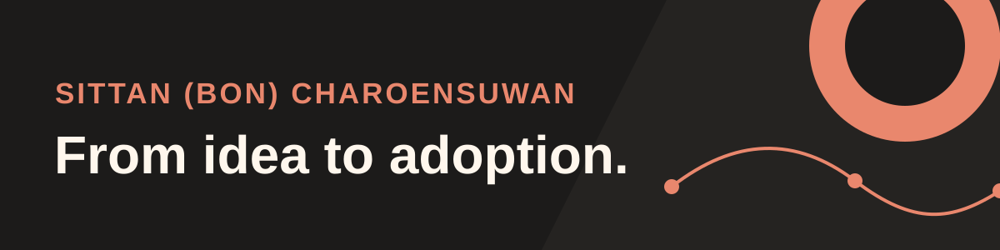

  

### Hi, I'm Bon 👋

I turn emerging technology into creative ideas and practical solutions people want to use. My work connects **AI implementation, product thinking, creative strategy, and human adoption** — from finding the right problem to testing an approach and making it useful in everyday work.

**[Explore my portfolio](https://sittanbon.github.io/)** · **[View my journey and CV](https://sittanbon.github.io/journey.html)** · **[Connect on LinkedIn](https://www.linkedin.com/in/sittan-charoensuwan/)**

---

### Technical skills in practice

**n8n · AI workflow design · React · React Native · Expo · TypeScript · JavaScript · gamification · Node.js · Express · SQLite · REST APIs · accessible interfaces · testing**

I use these tools to move from a useful idea to a tested product or workflow. **[Explore the visual skills page →](https://sittanbon.github.io/skills.html)** Each skill links to public code or a clearly labeled case study.

### Selected work

**01 / GenAI campaign workflow** · Delivered rollout  
Built an n8n proof of concept, tested it at two AI-enabled and two comparison locations, then helped roll it out across four operating DACH locations. The standard production cycle went from two weeks to one, with human approval in place. **[Read the case study →](https://sittanbon.github.io/genai-workflow-case-study.html)**

**02 / AI Expense Intelligence** · Internal pilot and product concept  
Interviewed 30+ SME finance users, tested OCR extraction on 500+ receipts, and designed confidence-based human review for an internal pilot. **[Read the case study →](https://sittanbon.github.io/finance-ai-case-study.html)**

**03 / Prompt Smash!** · Independent build  
Built an interactive guide that teaches prompt design through four journeys, with a responsible-AI review in every journey. It runs in the browser and keeps learners' drafts on their device. **[Try it →](https://sittanbon.github.io/prompt-smash/)** · [View code](https://github.com/SittanBon/prompt-smash)

**04 / Mochi Pop 🍡** · Playable independent build  
Built a cross-platform stress-relief tapping game with Expo and React Native. Combos, candy, XP, pet care and unlockable looks create a playful loop; progress saves on the device. **[Play the browser preview →](https://sittanbon.github.io/mochi-pop/)** · [View code](https://github.com/SittanBon/mochi-pop)

**05 / Bierpreis** · Independent MVP  
Built a Munich beer-price explorer with a map, search and filters, price-freshness signals, and community reporting. **[View project →](https://github.com/SittanBon/muenchner-bierpreis)**

**06 / QR Event Management** · Internal pilot and market learning  
Piloted a QR event product, licensed it to five market competitors, and used their feedback to improve it. The broader CRM, live-content, and gamification journey is a separate concept. **[Read the case study →](https://sittanbon.github.io/event-engagement-case-study.html)**

**[See the project workflow diagrams →](WORKFLOWS.md)**

### More to explore

- **[Creative experiences](https://sittanbon.github.io/creative-experiences.html)** — brand communication, digital interaction, and audience engagement.
- **[Technology experience](https://sittanbon.github.io/technology-experience.html)** — IIoT research and roadmapping, academic research, and hands-on prototypes.
- **[AI at Work: The Legal Layers](https://sittanbon.github.io/ai-legal-layers/)** and **[Ethical AI Now](https://sittanbon.github.io/ethical-ai-now/)** — practical resources for responsible AI use.

### How I work

**Imagine** the opportunity → **Shape** a useful solution → **Prove** it with evidence → **Adopt** it with people.

If you are working on a problem where technology, business, and human behavior meet, **[let's connect](mailto:sittan.siri@gmail.com)**.
