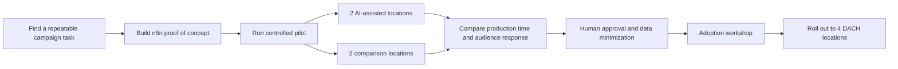
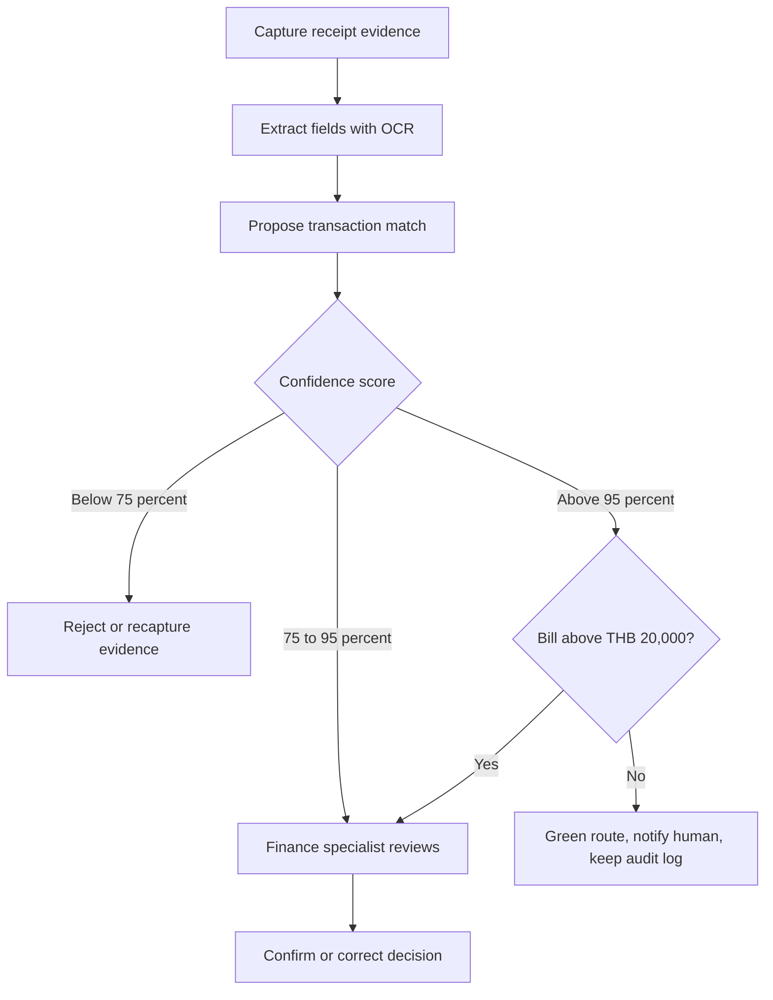
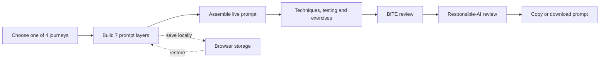
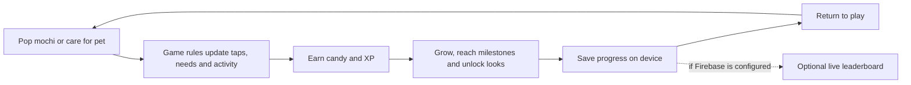
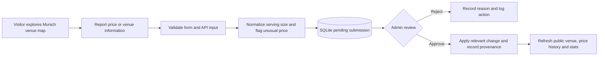
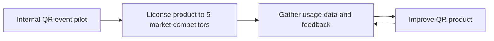
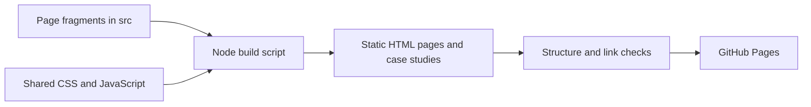

# Project workflows

These diagrams show what a visitor should understand quickly: the inputs, decisions, human involvement, and result. **Delivered work, pilots, public code, and concept designs are labeled separately.** The diagrams summarize the linked case studies or repositories; they are not exports of private production systems.

## GenAI campaign workflow — delivered implementation

The public case study contains a separate, more detailed *proposed creative route*. This diagram covers only the implementation steps described for the n8n proof of concept, pilot, and rollout.

The reported standard campaign cycle moved from about two weeks to one in the pilot. The exact internal automation steps are not public, so the diagram does not present a node-by-node n8n export. [Read the case study](https://sittanbon.github.io/genai-workflow-case-study.html).

## AI Expense Intelligence — internal pilot decision flow

The pilot tested receipt OCR and confidence-based routing. The broader finance dashboard shown in the case study is a product concept.

The thresholds describe Bon's stated pilot policy, including human review at exactly 75%. The case-study confidence factors and interface wireframes illustrate a possible product design; their precise weights are not claimed as pilot settings. [Read the case study](https://sittanbon.github.io/finance-ai-case-study.html).

## Prompt Smash! — public application flow

The four learning journeys share one React and TypeScript interaction engine. A pure assembler turns the learner's answers into the live prompt; required Goal and Task fields must be present before copy or download.

The responsible-AI review asks the learner to check risk, injection, hallucination, bias, and data protection; it does not declare a prompt safe. The browser stores drafts locally. [Try Prompt Smash!](https://sittanbon.github.io/prompt-smash/) · [Read the code](https://github.com/SittanBon/prompt-smash).

## Mochi Pop — public game loop

Mochi Pop is a playable Expo and React Native project with a browser preview. The core loop connects tactile play to pet care and progression; state is saved locally. The leaderboard is optional and requires Firebase configuration.

The browser preview uses a short stroll instead of the phone step counter, and vibration depends on browser support. Future quests, teams and app-store release are not presented as shipped features. [Play the browser preview](https://sittanbon.github.io/mochi-pop/) · [Read the code](https://github.com/SittanBon/mochi-pop).

## Bierpreis — public price-reporting flow

This is the flow implemented in the public React front end and Express API. Submitted information stays pending until an administrator reviews it.

The app also supports search, filters, price freshness, trends, bilingual content, and data-quality review. A flag is a review signal, not an automatic rejection. [Read the code](https://github.com/SittanBon/muenchner-bierpreis).

## QR Event Management — pilot and learning loop

The QR product was piloted internally and licensed to five market competitors. CRM, live streaming, gamification, rewards, and the dashboard on the case-study page are a separate design exploration.

[Read the case study](https://sittanbon.github.io/event-engagement-case-study.html).

## Portfolio website — public build flow

The portfolio itself is a static GitHub Pages project. Editable page fragments are assembled into visitor-facing pages with shared navigation, metadata, styles, and scripts.

[Explore the portfolio](https://sittanbon.github.io/) · [Read the repository](https://github.com/SittanBon/sittanbon.github.io).
